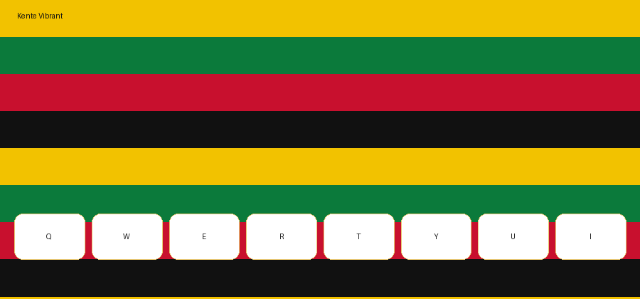
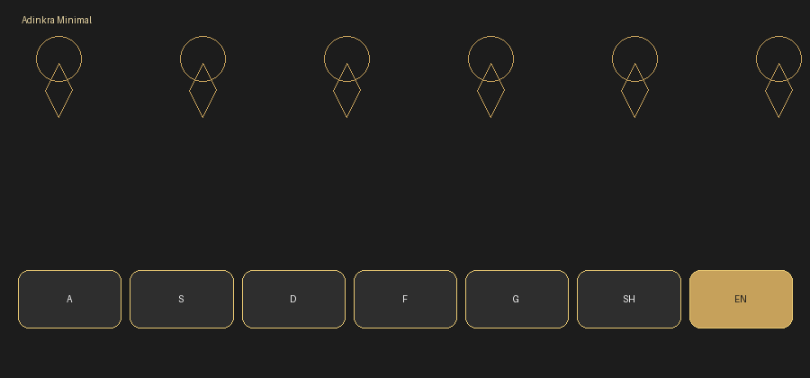
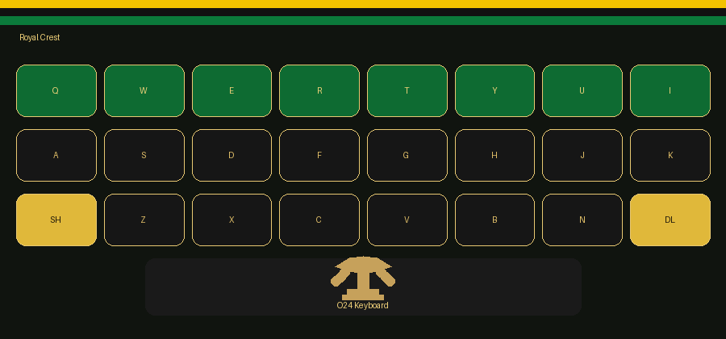
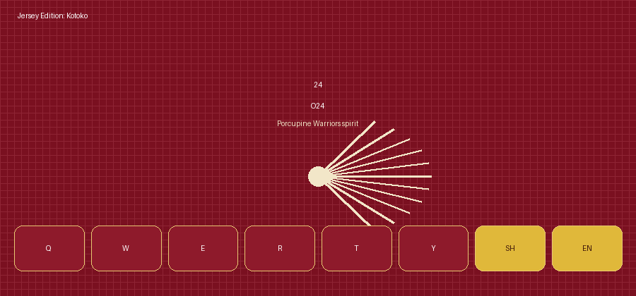

# Otumfour

Otumfour is an Android keyboard made in honour of the Asantehene, the king of Asante (Ashanti) in Ghana. It is an independent app. It is not a publication of Manhyia Palace. The welcome slide shows one credited photograph of Otumfuo Osei Tutu II. The keyboard itself does not depict a person.

The name Otumfour is a popular spelling of the title Otumfuo. Where a tagline needs a number, it is written 024.

## Features

- A full input method (QWERTY, shift and caps, numbers and symbols, backspace, enter, emoji, and a spacebar). The spacebar reads **Otumfour**, or **OTUMFOUR** in the Sika Dwa Kofi theme.
- Ghanaian languages on a switcher pill: English, Asante Twi, Akuapem Twi, Fante, Ga, Ewe, Dagbani, Dagaare, Gonja, Nzema, Kasem, and Hausa as written in Ghana. The extra letter row changes with the language (`ɛ ɔ ŋ ƒ ʋ ɖ ɣ`, and Hausa `ɓ ɗ ƙ ƴ`, with capitals).
- A suggestion bar with three candidates. Correction is conservative: a word that is already in a dictionary or learned list is kept, and an automatic change happens only for a one-step edit of a frequent word, on space or punctuation. Backspace puts the original back. Seed lists live in `app/src/main/assets/dictionaries/` as `word` or `word<tab>frequency`. Add lines to extend a language. Lines starting with `#` are comments.
- **AI** rewrite (Improve, Formal, Casual, Shorter, Fix spelling) and translate into English, Asante Twi, Akuapem Twi, Fante, Ga, Ewe, Dagbani, Dagaare, Gonja, Nzema, Kasem, or Hausa. This runs through Otumfour's server. No key is stored in the app. Text is sent only when you tap AI or Translate. Settings shows an on/off switch and a short privacy note. A custom endpoint is hidden until the version number on About is tapped seven times, and it is used only if the endpoint, model, and key are all filled in.
- Ten themes, each shown as a real mini keyboard in a carousel during onboarding and again from settings. Each theme has a history card. You can switch back to any theme, including Golden Stool Royal. Patterns are original drawings. The welcome slide uses one real photograph: Otumfuo Osei Tutu II in regalia, by Zackagonii, [CC BY-SA 4.0](https://creativecommons.org/licenses/by-sa/4.0/), via [Wikimedia Commons](https://commons.wikimedia.org/wiki/File:Ashanti_King_Otumfour_Osei_Tutu_II.jpg). The app credits that photo on the About page.
- A settings home with cards for Themes, Languages, Typing, AI, Learned words, and About. Languages use a default-language selector. Typing holds autocorrect, auto-capitalise, vibration, and key sound. Layouts follow window size: centred on a normal phone, a wider column on a large phone or fold, and two panes on a tablet.

### Themes

1. **Golden Stool Royal** — black keys, gold edges, and a gold weave.
2. **Kente Vibrant** — gold, green, red, and black stripes behind white rounded keys.
3. **Adinkra Minimal** — charcoal, faint Gye Nyame and Sankofa, gold shift and enter.
4. **Asante Flag** — gold, black, and green bands with a faint Golden Stool. Dark translucent keys, white letters.
5. **Sika Dwa Kofi** — black ground, a glowing Golden Stool with bells, gold-edged keys. The spacebar reads OTUMFOUR. Enter is gold.
6. **Royal Crest** — a thin gold, black, and green stripe. The top letter row is green, middle keys are black, and shift, delete, enter, and 123 are gold. A small stool sits on the spacebar.
7. **Okomfo Anokye** — red-brown and black, faint Adinkra, stone-dark keys, gold shift and enter. Preview art shows the stool in storm light and a sword in stone. It does not show a person.
8. **Yaa Asantewaa** — royal purple, faint gold Adinkra and kente bands, plum keys, gold shift and enter. Preview art shows her name, “Queen Mother of Ejisu, 1900”, two crossed swords, a crown, and the Golden Stool. It does not show her.

**Jersey Edition** (grouped in onboarding and settings; original drawings, not club crests):

9. **Kotoko** — deep red mesh, white letters, white and gold piping, gold shift and enter. Header art is the back of a shirt: a large 24, the mark 024, a geometric quill, and “Porcupine Warriors spirit”. It does not use Asante Kotoko’s crest or other trademarked artwork.
10. **Asanteman** — gold, black, and green jersey bands, a drawn Golden Stool, a large gold 24 and ASANTEMAN. Black mesh keys with gold letters, a green shift key, and a gold enter key.

The Golden Stool is drawn as an Asante stool: a curved crescent seat, a carved pillar, a rectangular base, and hanging bells.

History cards are in `app/src/main/res/values/strings.xml` so they can be translated. They end with the note “Summaries are for cultural appreciation.”

## Keys you may set

None of these are required to install or type.

| Setting | Where | Needed for |
| --- | --- | --- |
| AI endpoint, model, and key | Hidden. Tap the version number on About seven times. Used only if all three are filled in | Your own OpenAI-compatible server instead of Otumfour |
| `KEYSTORE_BASE64`, `KEYSTORE_PASSWORD`, `KEY_ALIAS`, `KEY_PASSWORD` | GitHub Actions secrets | Optional. Without them the release APK is signed with the committed **test** key (`keystore/o24-test.jks`, password `o24keyboard`, alias `o24`). Do not use that key for Play Store. |

Rewrite and translate use Otumfour's server by default. Text is sent only after you tap **AI** or **Translate**, and only up to 2000 characters. Password fields are skipped. The OpenAI key is not in this app.

## Theme previews

Original drawings, not photographs and not people:












## Install

The project is a Gradle app. Debug and release APKs are attached to this repository’s GitHub Actions run (`o24-keyboard-apk`). A tag named `v*` also publishes them on a GitHub Release.

On a computer:

```bash
./gradlew assembleDebug
```

The debug APK is `app/build/outputs/apk/debug/app-debug.apk`. The release APK is `app/build/outputs/apk/release/app-release.apk`.

Sideload:

1. Copy the APK to the phone, or use `adb install -r app-debug.apk`.
2. If Android asks, allow install from this source.
3. Open **Otumfour**. The first screen asks you to enable it, then to choose a theme.
4. Enable it under **Settings → System → Languages & input → On-screen keyboard** (wording varies). Then select **Otumfour** in the input picker.
5. Open a text field and choose Otumfour if it is not already selected.

## Build

- Kotlin, minSdk 24, targetSdk 35.
- `./gradlew assembleDebug` and `./gradlew testDebugUnitTest`.
- CI: `.github/workflows/android.yml`.

## Limits

- The dictionaries are seeds, not full lexicons. Several Ghanaian lists are short and marked for native-speaker review. Suggestions improve as you add lines or as the keyboard learns words.
- Built-in AI sends the text you ask to rewrite or translate, up to 2000 characters, to Otumfour's server. A custom endpoint is used only if you fill in the endpoint, model, and key after unlocking developer tools.
- The only photograph of a person is the credited regalia portrait on the welcome slide. It is not shown on the keyboard.
