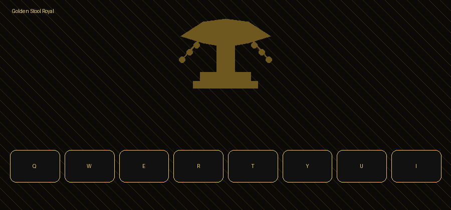
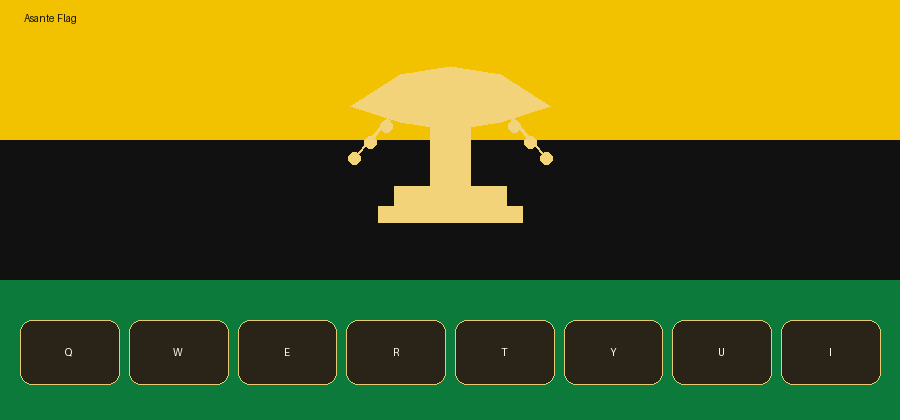
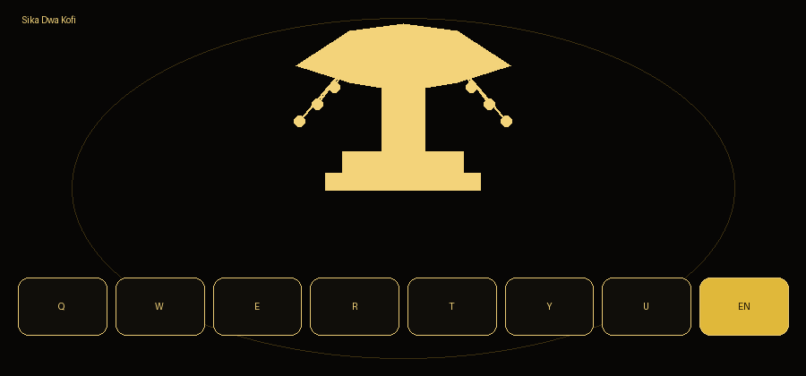
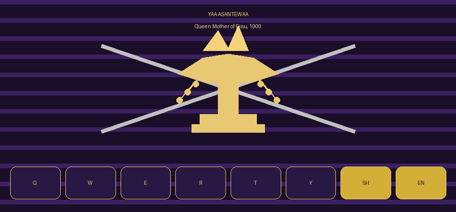
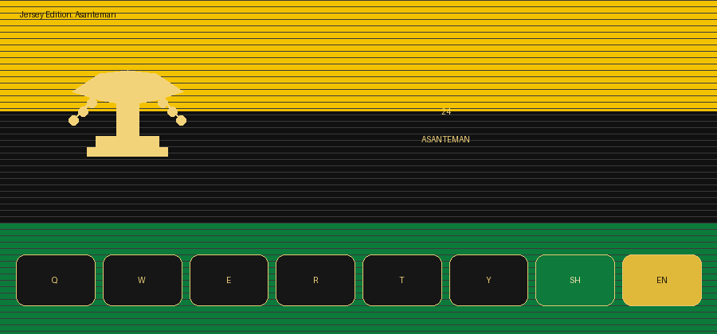

# Otumfour · O24 Keyboard

O24 Keyboard, also called Otumfour, is an Android keyboard made in honour of the Asantehene, the king of Asante (Ashanti) in Ghana. It is an independent app. It is not a publication of Manhyia Palace, and it does not depict the Asantehene or any other person.

The name Otumfour is a popular spelling of the title Otumfuo. O24 is the short name.

## Features

- A full input method (QWERTY, shift and caps, numbers and symbols, backspace, enter, emoji, and a spacebar). The spacebar reads **O24 Keyboard**, or **OTUMFOUR** in the Sika Dwa Kofi theme.
- Ghanaian languages on a switcher pill: English, Asante Twi, Akuapem Twi, Fante, Ga, Ewe, Dagbani, Dagaare, Gonja, Nzema, Kasem, and Hausa as written in Ghana. The extra letter row changes with the language (`ɛ ɔ ŋ ƒ ʋ ɖ ɣ`, and Hausa `ɓ ɗ ƙ ƴ`, with capitals).
- A suggestion bar with three candidates. Correction uses edit distance and word frequency. Words you accept are remembered on the phone. Seed lists live in `app/src/main/assets/dictionaries/` as `word` or `word<tab>frequency`. Add lines to extend a language. Lines starting with `#` are comments.
- **Serwaa**, the voice from TraffiAlert GH. Tap the mic to dictate. Hold it to hear a greeting. She speaks replies with the same Android settings as TraffiAlert: British English, rate `0.95`, pitch `1.05`, navigation-guidance audio, and the clearest installed offline voice of the same family. See below.
- **AI** rewrite (Clear, Formal, Warm, Shorter) and **Translate** between English and the active Ghanaian language. Both use a pluggable OpenAI-compatible endpoint. With no key, the keyboard says so and does not call out.
- Ten themes, chosen in onboarding and changeable in settings. Jersey Edition is grouped on its own. Each theme has a short history card (Learn more, settings, and About). Patterns are original drawings, not photographs.
- A settings app: enable the keyboard, pick a theme, choose languages, personalise Serwaa, set AI and optional cloud TTS, and read an About page for Otumfuo.

### Themes

1. **Golden Stool Royal** — black keys, gold edges, a gold weave, a glowing Serwaa mic.
2. **Kente Vibrant** — gold, green, red, and black stripes behind white rounded keys.
3. **Adinkra Minimal** — charcoal, faint Gye Nyame and Sankofa, gold shift and enter.
4. **Asante Flag** — gold, black, and green bands with a faint Golden Stool. Dark translucent keys, white letters.
5. **Sika Dwa Kofi** — black ground, a glowing Golden Stool with bells, gold-edged keys. The spacebar reads OTUMFOUR. Enter is gold.
6. **Royal Crest** — a thin gold, black, and green stripe. The top letter row is green, middle keys are black, and shift, delete, enter, and 123 are gold. A small stool sits on the spacebar.
7. **Okomfo Anokye** — red-brown and black, faint Adinkra, stone-dark keys, gold shift and enter. Preview art shows the stool in storm light and a sword in stone. It does not show a person.
8. **Yaa Asantewaa** — royal purple, faint gold Adinkra and kente bands, plum keys, gold shift and enter. Preview art shows her name, “Queen Mother of Ejisu, 1900”, two crossed swords, a crown, and the Golden Stool. It does not show her.

**Jersey Edition** (grouped in onboarding and settings; original drawings, not club crests):

9. **Kotoko** — deep red mesh, white letters, white and gold piping, gold shift and enter. Header art is the back of a shirt: a large 24, O24, a geometric quill, and “Porcupine Warriors spirit”. It does not use Asante Kotoko’s crest or other trademarked artwork.
10. **Asanteman** — gold, black, and green jersey bands, a drawn Golden Stool, a large gold 24 and ASANTEMAN. Black mesh keys with gold letters, a green shift key, and a gold enter key.

The Golden Stool is drawn as an Asante stool: a curved crescent seat, a carved pillar, a rectangular base, and hanging bells.

History cards are in `app/src/main/res/values/strings.xml` so they can be translated. They end with the note “Summaries are for cultural appreciation.”

## Serwaa, from TraffiAlert GH

Searched these repositories for a Serwaa voice model, voice id, TTS config, prompts, and audio:

| Repository | What is there |
| --- | --- |
| [OriginalSolution/traffitech-gh-alert](https://github.com/OriginalSolution/traffitech-gh-alert) branch `cursor/traffialert-gh-v1-4c59` | The voice. Not on `main`. |
| [TraffiAlertGH/traffialert-site](https://github.com/TraffiAlertGH/traffialert-site) | Landing page. Maame portrait assets. No Serwaa voice. `HANDOFF.md` points at the app branch above. |
| [OriginalSolution/traffialert-site](https://github.com/OriginalSolution/traffialert-site) | Older site checkout. Maame images. No Serwaa voice. |
| [TraffiAlertGH/traffialert-pay](https://github.com/TraffiAlertGH/traffialert-pay) | Empty repository. |

What the app branch actually contains:

- The name **Serwaa**, spoken **Sirwaah**. The recorded introduction is: “Hi, I'm Sirwaah, your Traffic Alert voice.”
- Hundreds of mp3 clips in `assets/voice/serwaa/`, generated as recorded lines (`scripts/serwaa-lines.json`, `src/i18n/voice/speak.ts`). That is the timbre. There is **no ElevenLabs, OpenAI, or other cloud voice id** in the source.
- Android TTS fallback in `AlertVoice.kt`: locale `en-GB` (then `en-US`), rate `0.95`, pitch `1.05`, usage `ASSISTANCE_NAVIGATION_GUIDANCE`, and the highest-quality installed offline voice of the same family.
- `docs/VOICE_RECORDING.md` says Khaya / GhanaNLP could synthesise Ghanaian languages, but TraffiAlert does not call it. That API would need the publisher’s own key. No such key is stored in the repo.

This keyboard uses that persona and those TTS settings. It does **not** copy secret keys.

The clip files could not be copied into this repo from here: the build environment’s git credential cannot read the private TraffiAlert app repo. If you have a checkout, run:

```bash
scripts/import-serwaa-clips.sh /path/to/traffitech-gh-alert
```

That copies `intro.mp3`, `welcome_back.mp3`, `praise.mp3`, and `app_on.mp3`. Lines that match those clips then play Serwaa’s recording. Everything else uses the phone voice with her settings.

A cloud voice can be attached later. In settings, set a TTS URL and key. The keyboard `POST`s JSON (`text`, `voice: serwaa`, `language: en-GB`, `rate`, `pitch`) and expects `audio/mpeg` or `audio/wav` back. If that fails, it falls back to Android TTS. Nothing is hardcoded.

## Keys you may set

None of these are required to install or type.

| Setting | Where | Needed for |
| --- | --- | --- |
| AI endpoint | In the app (for example `https://api.openai.com/v1`) | Rewrite and translate |
| AI API key | In the app, stored only on the phone | Rewrite and translate |
| AI model | In the app, default `gpt-4o-mini` | Rewrite and translate |
| Cloud TTS endpoint and key | In the app | Optional recorded-style playback from your own Serwaa service |
| `KEYSTORE_BASE64`, `KEYSTORE_PASSWORD`, `KEY_ALIAS`, `KEY_PASSWORD` | GitHub Actions secrets | Optional. Without them the release APK is signed with the committed **test** key (`keystore/o24-test.jks`, password `o24keyboard`, alias `o24`). Do not use that key for Play Store. |

Rewrite and translate send text only after you tap **AI** or **Translate**, and only when both an endpoint and a key are saved. Password fields are skipped.

## Theme previews

Original drawings, not photographs and not people:












## Install

The project is a Gradle app. Debug and release APKs are attached to this repository’s GitHub Actions run (`o24-keyboard-apk`). A tag named `v*` also publishes them on a GitHub Release.

On a computer:

```bash
./gradlew assembleDebug
```

The debug APK is `app/build/outputs/apk/debug/app-debug.apk`. The release APK is `app/build/outputs/apk/release/app-release.apk`.

Sideload:

1. Copy the APK to the phone, or use `adb install -r app-debug.apk`.
2. If Android asks, allow install from this source.
3. Open **O24 Keyboard**. The first screen asks you to enable it, then to choose a theme.
4. Enable it under **Settings → System → Languages & input → On-screen keyboard** (wording varies). Then select **O24 Keyboard** in the input picker.
5. Allow the microphone if you want Serwaa to take dictation.

## Build

- Kotlin, minSdk 24, targetSdk 35.
- `./gradlew assembleDebug` and `./gradlew testDebugUnitTest`.
- CI: `.github/workflows/android.yml`.

## Limits

- The dictionaries are seeds, not full lexicons. Several Ghanaian lists are short and marked for native-speaker review. Suggestions improve as you add lines or as the keyboard learns words.
- Twi, Ga, Ewe, and most other Ghanaian languages have no reliable Android voice. Serwaa’s spoken replies stay on the TraffiAlert English voice (`en-GB`). Dictation uses `en-GH`, or `ha-GH` for Hausa, which depends on what the phone has installed.
- Her exact timbre is the TraffiAlert mp3 set. Until those clips are imported, or you point settings at a TTS service that returns her audio, you hear the phone voice with her rate, pitch, and locale.
- AI rewrite and translate do nothing useful until you save your own endpoint and key.
- There is no picture of a person anywhere in this project on purpose.
